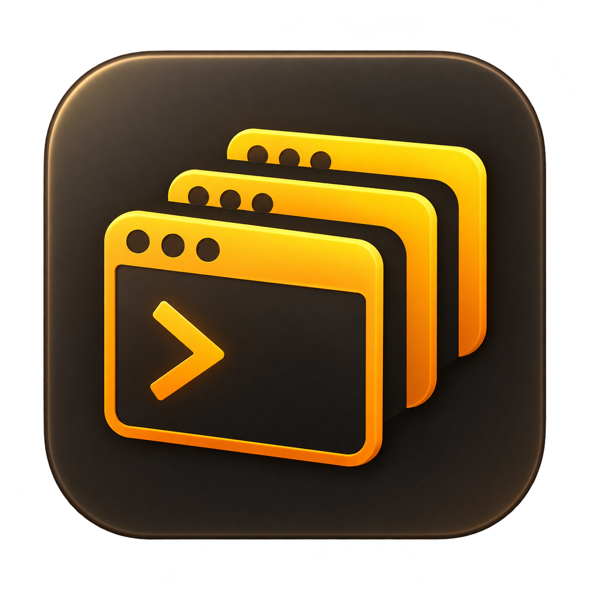

# TerminalMgr

Windows-Arbeitsplatz für mehrere SSH-Verbindungen mit tmux, schnellem Session-Wechsel und angedocktem Clipboard.



## Erste Version

- OpenSSH-Config automatisch beim ersten Start oder manuell importieren. Explizite Host-Aliase und Includes werden erkannt; Host/Match, Schlüssel, ProxyJump und RemoteCommand wertet Windows OpenSSH aus.
- Mehrere Verbindungen parallel offen halten und über Serverliste oder Alt+1 bis Alt+9 wechseln.
- Ctrl+B und weitere tmux-Tasten unverändert weiterreichen.
- Fenster, Seitenbereiche und Schriftgröße ändern: neue Zeilen/Spalten werden über ConPTY und OpenSSH bis zum Linux-PTY weitergegeben.
- Pro Profil beim App-Start automatisch verbinden. Startmodi: SSH-Config, tmux erstellen/anhängen oder eigener Remote-Befehl.
- Rechtsklick auf Server → **tmux-Session auswählen …**: vorhandene Sessions mit Fensteranzahl und aktiven Verbindungen abfragen und öffnen.
- Rechtsklick → **tmux-Fensterwahl öffnen** sendet Ctrl+B, dann w.
- Rechtsklick zeigt darunter **alle tmux-Sessions des Servers mit ihren Fenstern** („Index: Name“, bei abweichendem Programm mit „(vim)“; ● markiert das aktive Fenster, „verbunden“ die Session, an der TerminalMgr hängt). Das Menü öffnet sofort, die Liste kommt per separater SSH-Abfrage (Key/Agent, kein Passwortdialog, 10 s Zeitlimit) und funktioniert auch bei nicht verbundenem Server. Bei mehr als etwa 25 Einträgen gibt es ein Untermenü je Session.
- Klick auf ein Fenster wechselt den eigenen tmux-Client dorthin (auch in eine andere Session, die bisherige läuft weiter). Ist der Server nicht verbunden, wird verbunden und direkt an dieses Fenster angehängt. Es werden Session- und Fenster-IDs verwendet, nicht Namen.
- Clipboard mit Herkunft, Suche, Anheften, gezieltem Einfügen und Drag-and-drop.
- Gewähltes Icon: Vorschlag 3 „Sessions“, in sieben Auflösungen von 16 bis 256 Pixeln.

## Installation für Einsteiger

TerminalMgr läuft unter Windows 10 und 11 und braucht keine Installation von .NET. Zwei Dinge müssen vorhanden sein, beide sind bei Windows 11 meist schon da: der **OpenSSH-Client** und die **Microsoft Edge WebView2 Runtime**.

**1. Die richtige Datei wählen.** Auf der Seite [Releases](https://github.com/oweindl/TerminalMgr/releases/latest) stehen drei Pakete:

| Ihr PC | Datei |
|---|---|
| Fast alle Windows-PCs (Intel oder AMD, 64 Bit) | `TerminalMgr-win-x64-<Version>.zip` |
| PCs mit Snapdragon- oder anderem ARM-Prozessor (z. B. Surface Pro 11, Copilot+ PCs) | `TerminalMgr-win-arm64-<Version>.zip` |
| Sehr alte 32-Bit-Windows-PCs | `TerminalMgr-win-x86-<Version>.zip` |

Nicht sicher? **Windows-Einstellungen › System › Info › „Systemtyp“** zeigt es an („64-Bit-Betriebssystem, x64-basierter Prozessor“ → x64; „ARM-basierter Prozessor“ → arm64). Im Zweifel die x64-Datei nehmen.

**2. Herunterladen und entpacken.** Die ZIP-Datei laden, mit der rechten Maustaste anklicken und **„Alle extrahieren …“** wählen.

**3. In den richtigen Ordner legen.** Windows-Taste + R drücken, `%LOCALAPPDATA%\Programs` eingeben, Enter. Dort einen Ordner `TerminalMgr` anlegen und den **Inhalt** des entpackten Ordners hineinkopieren, sodass `TerminalMgr.App.exe` direkt in `...\Programs\TerminalMgr` liegt. In diesem Ordner kann sich TerminalMgr später selbst aktualisieren.

**4. Verknüpfung anlegen.** Rechtsklick auf `TerminalMgr.App.exe` › **Senden an › Desktop (Verknüpfung erstellen)**.

**5. Starten.** Beim ersten Start warnt Windows möglicherweise („Der Computer wurde durch Windows geschützt“), weil die Datei nicht signiert ist: **„Weitere Informationen“ › „Trotzdem ausführen“**. Danach SSH-Profile über **Import** (liest Ihre `~/.ssh/config`) oder **+ Profil** anlegen.

**Es geht auch mit einem Befehl.** In einer PowerShell (Startmenü › „PowerShell“) einfügen und Enter drücken; das Skript erkennt den Prozessor, lädt das passende Paket, prüft die Prüfsumme und legt die Verknüpfungen an:

```powershell
irm https://raw.githubusercontent.com/oweindl/TerminalMgr/main/scripts/Install-TerminalMgr.ps1 -OutFile $env:TEMP\Install-TerminalMgr.ps1; powershell -ExecutionPolicy Bypass -File $env:TEMP\Install-TerminalMgr.ps1 -Start
```

**Falls etwas fehlt:**
- *OpenSSH-Client:* Einstellungen › System › Optionale Features › „Funktion hinzufügen“ › „OpenSSH-Client“.
- *WebView2 Runtime:* [Download bei Microsoft](https://go.microsoft.com/fwlink/p/?LinkId=2124703) (Windows 11 hat sie schon).

**Aktualisieren.** TerminalMgr sucht beim Start selbst nach einer neueren Version, fragt nach und lädt das Paket **für den eigenen Prozessor** herunter (die Prüfsumme wird kontrolliert, bei einem Fehler bleibt die alte Version erhalten). Einstellungen, angeheftete Clipboard-Einträge und Sprachmodelle liegen in `%LOCALAPPDATA%\TerminalMgr` und bleiben bei jeder Installation und jedem Update erhalten.

**Hinweis zum Diktat auf ARM-PCs und 32-Bit:** Die Spracherkennung läuft dort auf dem Prozessor; die Grafikkarten-Beschleunigung (Vulkan) gibt es nur im x64-Paket. Das Diktat ist dort deutlich langsamer.

## Starten

Windows 10 1809 oder neuer / Windows 11, Windows OpenSSH-Client und Microsoft Edge WebView2 Runtime werden benötigt.

Das eigenständige Paket startet über TerminalMgr.App.exe. Den gesamten Paketordner behalten. Ein lokaler Build benötigt zusätzlich die .NET-8-Desktop-Runtime (im SDK enthalten).

Beim ersten Start wird %USERPROFILE%\.ssh\config importiert. Profile werden zunächst nicht automatisch verbunden. Im Profil „Beim Start von TerminalMgr automatisch verbinden“ aktivieren.

### Startmodi

| Modus | Verhalten |
| --- | --- |
| SSH-Config | Bestehende Einstellungen inklusive RequestTTY und RemoteCommand gelten. |
| tmux | tmux new-session -A -s NAME; optionaler Befehl läuft nur bei einer neuen Session. |
| Remote-Befehl | Läuft bei jedem Verbindungsaufbau. Endet der Befehl, endet SSH. Für eine anschließende Shell z. B.: dein-befehl; exec bash -l. |

Bei tmux und Remote-Befehl wird RemoteCommand gezielt überschrieben. Der Kindprozess erhält TERM=xterm-256color.

Die tmux-Auswahl verwendet eine separate nicht interaktive SSH-Abfrage mit SSH-Key/Agent. Sie verändert die laufende Session nicht. Erst „Session öffnen“ trennt die bisherige Client-Verbindung und hängt eine neue an die Auswahl an. Die Auswahl gilt für diese Verbindung; das gespeicherte Startprofil bleibt bestehen. Das direkte Fenstermenü und der Wechsel per Klick setzen Ctrl+B als tmux-Präfix voraus. Der Wechsel sendet Präfix und „:“, wartet kurz, bis tmux den Befehlsprompt geöffnet hat, und gibt dann `switch-client -t '$session:@fenster'` ein; so landen keine Zeichen im laufenden Programm.

### Clipboard

Maus wie bei PuTTY:

- Links ziehen markiert (Doppelklick: Wort, Dreifachklick: Zeile). **Rechtsklick mit Markierung** kopiert in die Windows-Zwischenablage und in die Liste und hebt die Markierung auf. **Rechtsklick ohne Markierung** fügt den aktiven Listeneintrag in die Session ein.
- Nachgestellte Leerzeichen je Zeile (Terminalbreite) werden beim Kopieren entfernt.
- Der Rechtsklick im Terminal gehört immer der App und erreicht nie die Session. Bei aktivem Maus-Tracking (tmux `mouse on`, vim, htop) markiert **Umschalt + Ziehen** trotzdem lokal.
- **Links öffnen:** Adressen mit `http://` oder `https://` in der Ausgabe werden beim Überfahren unterstrichen; **Strg + Linksklick** öffnet sie im Standardbrowser. Ein einfacher Klick bleibt beim Programm (z. B. tmux). Andere Adressen (`file:`, `ftp:` und so weiter) öffnet die App nie.
- Ctrl+Shift+C kopiert die Markierung wie der Rechtsklick, Ctrl+Shift+V fügt die Windows-Zwischenablage ein.
- **Einheitliche Bedienung:** In der Shell, in tmux und in Claude Code gilt dasselbe. Vorgabe: Eine Markierung mit der Maus wird erst mit **Rechtsklick** übernommen (in tmux und Claude Code zeigt ein Hinweis „Markiert. Rechtsklick kopiert“; er gilt 30 Sekunden). *Einstellungen › Markierung sofort kopieren* schaltet um: Dann wird jede Markierung beim Loslassen der Maustaste kopiert, überall. Kopien ohne Maus (tmux-Kopiermodus mit `y`, Skripte) kommen immer sofort an.
- **Markieren in Claude Code oder tmux:** Programme mit eigener Maus-Unterstützung (Claude Code, tmux mit `mouse on`) markieren selbst; xterm.js hat dann keine Markierung, ein Rechtsklick würde einfügen. Beim Loslassen kopieren sie aber in den tmux-Puffer, und tmux meldet das per OSC 52 an das Terminal. TerminalMgr übernimmt diese Schreibanfragen: Text landet oben in der Clipboard-Liste (Herkunft Sessionname, aktiv) und in der Windows-Zwischenablage, der nächste Rechtsklick fügt ihn ein. Lesen der Zwischenablage durch ein Programm ist nie möglich (Leseanfragen werden nicht beantwortet). Abschaltbar unter *Einstellungen* (Vorgabe an). Geprüft mit tmux 3.6 und der tmux-Vorgabe `set-clipboard external`; kommt bei Ihrer Konfiguration nichts an, in `~/.tmux.conf` `set -s set-clipboard on` eintragen. Zur Fehlersuche zeigt `TERMINALMGR_DEBUG=1` bei jedem Rechtsklick in der Statuszeile Markierung und Maus-Tracking-Modus.

Clipboard-Liste (rechts, neueste oben):

Kompakte Textzeilen ohne dauerhafte Buttonleiste. Herkunft, Zeit und Textlänge stehen gemeinsam unter der Vorschau; die aktive Zeile hat eine schmale Akzentkante. Rechtsklick oder „⋯“ beim Überfahren / Tastaturfokus öffnet Einfügen, Kopieren, Volltext, Anheften und Entfernen. Der Pin neben der Suche filtert angeheftete Einträge; das Kopfmenü enthält „Ungeheftete Einträge entfernen“.

- Alles, was in Sessions markiert oder in einem anderen Programm kopiert wird, landet automatisch oben und ist aktiv. Die Herkunft ist der Sessionname oder „Windows“. Einträge von Passwortmanagern (`ExcludeClipboardContentFromMonitorProcessing`, `CanIncludeInClipboardHistory` = 0) werden nicht übernommen.
- Erneut kopierter Text erzeugt kein Duplikat, sondern rückt nach oben.
- Klick macht einen Eintrag aktiv (der nächste Rechtsklick fügt ihn ein), Doppelklick fügt ihn sofort in die aktive Session ein. Die Vorschau zeigt zwei Zeilen; längere Texte enden mit „…“ und zeigen z. B. „42 Zeilen“. **Volltext gekürzter Einträge:** Bleibt der Mauszeiger etwa 0,4 s auf einem gekürzten Eintrag, erscheint links davon ein Popup mit dem ganzen Text in Monospace (Zeilenumbrüche erhalten, höchstens 60 % der Fensterhöhe und die Breite des Terminalbereichs, scrollbar); es bleibt offen, solange der Zeiger über Eintrag oder Popup ist. Ein Klick macht den Eintrag wie bisher aktiv und klappt ihn zusätzlich in der Liste auf (rund 15 Zeilen, darüber scrollbar); ein weiterer Klick oder ein anderer Eintrag klappt ihn wieder zu, es ist höchstens einer aufgeklappt. Der Text im Popup und im aufgeklappten Eintrag lässt sich markieren und mit Ctrl+C kopieren. Vollständig angezeigte Einträge haben kein Popup.
- „Anheften“ erhält einen Eintrag über Neustarts. Ungeheftete Einträge bleiben im Speicher, höchstens 100 (einstellbar unter *Einstellungen*).

Einfügen nutzt Bracketed Paste. Die App sendet keinen zusätzlichen Enter-Tastendruck. Remote-OSC52 ist deaktiviert; tmux-interne Copy-Mode-Puffer werden noch nicht automatisch in den lokalen Manager übernommen.

Einstellungen und angeheftete Texte liegen in %LOCALAPPDATA%\TerminalMgr\settings.json, also außerhalb des Installationsordners und bleiben bei Updates erhalten. SSH-Schlüssel und Passwörter verwaltet OpenSSH. Angeheftete Texte werden als Klartext gespeichert.

### Diktat

Gesprochener Text landet in einem Diktatfenster in der rechten Spalte unter der Clipboard-Liste (höchstens ein Drittel der Fensterhöhe, der Text scrollt mit; eine ausgeblendete Clipboard-Spalte kommt dafür zurück), ist dort korrigierbar und geht dann in die Session. Gedacht für Prompts an Claude Code und andere Programme in tmux.

- **Ctrl+Y** (oder Button „Diktat“ rechts unten über der Statusleiste) öffnet das Fenster und startet die Aufnahme. Ctrl+Y wird von der App abgefangen und erreicht die Session nie. Die Belegung ist unter *Einstellungen* änderbar; in bash/readline ist Ctrl+Y „yank“, das mit der Standardbelegung nicht erreichbar ist.
- Zielsession ist die beim Öffnen aktive; ihr Name steht im Titel. Ein späterer Serverwechsel ändert das Ziel nicht.
- Beim Sprechen erscheint nach etwa einer Sekunde ein Zwischenstand: bestätigte Wörter in normaler Schrift (sie ändern sich nicht mehr), der noch unsichere Rest grau und kursiv. Nach 1,5 s Stille (einstellbar) endet die Aufnahme; der endgültige Text ersetzt den Zwischenstand. Ohne Sprache endet sie nach 5 s und es wird nichts transkribiert. Erneut Ctrl+Y setzt fort, neuer Text kommt an die Cursorposition. Läuft die Aufnahme, beendet Ctrl+Y sie sofort.
- **Enter** fügt den Text ein (ohne Enter), **Ctrl+Enter** fügt ein und führt aus, **Shift+Enter** ist ein Zeilenumbruch, **Esc** bricht zuerst die Aufnahme ab und verwirft danach das Diktat. Eingefügt wird per Bracketed Paste; Steuerzeichen außer Zeilenumbruch und Tab werden entfernt, „Ausführen“ sendet danach genau ein Enter.
- Die Erkennung läuft lokal und offline mit whisper.cpp über Whisper.net (Grafikkarte per Vulkan, sonst CPU). Audio bleibt im Speicher und wird nicht gespeichert.
- Das Modell (Vorgabe `large-v3-turbo-q5_0`, ca. 0,6 GB; leichter: `small-q5_1`) liegt unter `%LOCALAPPDATA%\TerminalMgr\models`, nicht im Installationsordner. Der Download startet erst nach Rückfrage beim ersten Diktat, mit Fortschrittsanzeige und Abbruch.
- Zwischenstand: Das schnelle Modell `small-q5_1` (ca. 0,2 GB, nach Rückfrage geladen) erkennt auf der Grafikkarte nur die letzten bis zu 7 s Audio etwa alle 0,7 s; zwei übereinstimmende Ergebnisse bestätigen ein Wort. Der Endtext kommt vom eingestellten Modell.
- Drei Engines hinter einer Schnittstelle (Einstellungen › Diktat › Spracherkennung): Whisper (lokal, Vorgabe), Web Speech API in WebView2 und die Windows-Spracherkennung. Die beiden letzten laufen auf diesem System nicht (WebView2 hat keinen Spracherkennungsdienst; Windows verlangt „Onlinespracherkennung“, dann geht das Audio in die Cloud). Prüfung, Messungen und Messmodus: [docs/dictation-engines.md](docs/dictation-engines.md).
- Einstellungen: Tastenkürzel, Spracherkennung (Engine), Mikrofon, Modell, Modell für den Zwischenstand, Sprache (Deutsch, Englisch, automatisch), Fachbegriffe für die Erkennung (Initial-Prompt), Stilledauer und Pegelschwelle.

### Tastatur-Navigation durch tmux-Fenster und Server

Alle Wechsel laufen über den tmux-Befehlsweg des eigenen Clients (Präfix und `:`, dann der Befehl nach einer kurzen Pause), nie als Tastendruck für das laufende Programm. Geprüft gegen echtes tmux auf einem Testserver mit einem aufzeichnenden Programm im Fenster: in 28 Wechseln kam kein Byte im Programm an.

| Kürzel (Vorgabe) | Wirkung |
|---|---|
| Ctrl+0 … Ctrl+9 | tmux-Fenster mit diesem Index in der angezeigten tmux-Session |
| Ctrl+Tab / Ctrl+Shift+Tab | nächstes / voriges Fenster der Session (springt am Ende herum) |
| Ctrl+< | zurück zum zuletzt benutzten Fenster, auch auf einem anderen Server (eigener Verlauf der App; nochmal drücken wechselt wieder zurück) |
| Alt+1 … Alt+9 | Server wechseln (wie bisher) |
| Favoriten | eigenes Kürzel je Favorit, z. B. Ctrl+Alt+A; bei getrenntem Server wird verbunden |

Einstellungen › Tastenkürzel: Modifier für 0 bis 9 (Ctrl, Alt+Shift, Ctrl+Shift), Nächstes, Voriges, Zurück und „Favoriten verwalten …“. Doppelte Belegungen und Ctrl+B (tmux-Präfix) werden abgelehnt. Hinweis: Ctrl+0 bis 9 hatten im Terminal eine seltene Altbedeutung (Ctrl+3 = Escape); wer sie braucht, nimmt Alt+Shift. Ctrl+K und die anderen Readline-Tasten erreichen die Shell weiterhin. Die Taste `<` ist auf dem deutschen Layout die Taste links neben Y; wer lieber `^` nimmt, stellt „Zurück“ auf Ctrl+` ein.

Favoriten sind an Server, Session-Namen und Fenster-Namen gebunden, nicht an tmux-IDs (die ändern sich nach einem tmux-Neustart); bei gleichnamigen Fenstern gilt das erste. Fehlt das Fenster, erscheint ein Hinweis in der Statuszeile. Die Favoriten gehören zum Konfigurationsexport.

### Befehlspalette (Ctrl+Shift+K)

Ein Overlay über dem Terminal, in HTML und CSS in der Terminalseite (ein WPF-Element läge hinter dem WebView2). Eingabefeld mit unscharfer Suche (Groß-/Kleinschreibung und Umlaute egal, alle Wörter müssen passen), ↑/↓ wählen, Enter führt aus, Esc schließt. Alle Tasten gehen in das Eingabefeld, keine ins Terminal; Ctrl+K erreicht außerhalb der Palette weiter die Shell.

- Gruppen: **Favoriten**, **tmux-Fenster** aller verbundenen Server (Server › Session › Fenster), **Clipboard** (Enter fügt ein), **Aktionen** (Diktat, Verbinden/Trennen, Profil anlegen, Einstellungen, Export/Import, Updates, Zurück/Nächstes/Voriges).
- Neben jedem Treffer steht das Tastenkürzel (Ctrl+2, Ctrl+Alt+A …). Leere Eingabe zeigt Favoriten und die zuletzt benutzten Fenster.
- Die Palette erscheint sofort mit der zuletzt bekannten Liste; die tmux-Fenster werden beim Öffnen frisch abgefragt (`list-windows -a`) und ersetzen die Liste, ohne dass Eingabe oder Auswahl verloren gehen.
- **Ctrl+D** speichert das markierte Fenster als Favorit (Name und Kürzel in einem kleinen Dialog; Doppelbelegungen werden abgelehnt).

### Oberfläche (Redesign „Commander“)

Von links nach rechts: **Icon-Leiste** (Server, Clipboard, Diktat, unten Einstellungen), die **Serverliste** als Panel, das sich aus der Leiste auf- und zuklappt (Esc schließt es; es startet offen, wenn nichts automatisch verbindet), **Session-Tabs** (je verbundenem Server und für den gewählten ein Tab mit Statuspunkt: grün verbunden, Amber-Ring verbindet, ohne Punkt getrennt, dazu die Alt-Nummer; Rechtsklick öffnet das Server-Menü mit den tmux-Fenstern), das Terminal und rechts die Spalte mit **Clipboard** und darunter dem **Diktat**. Damit die Leiste oben ganz den Fenstern gehört, liegen **Schriftgröße (A− / A+)** und die Suche (**„Alles finden“**, öffnet die Palette) jetzt oben in der Clipboard-Spalte; der **Fokusmodus** sitzt unten in der Icon-Leiste (er blendet die Spalten aus und muss deshalb außerhalb liegen). Ist die Clipboard-Spalte zu, erreichst du die Palette mit Ctrl+Shift+K und die Schriftgröße nach dem Öffnen der Spalte wieder. Eine Statuszeile gibt es nicht mehr: Meldungen erscheinen kurz als Hinweis unten im Terminal, Maße und Hilfetexte in Tooltips.

Farben und Schriften stehen an einer Stelle (`Theme.Dark` in `TerminalMgr.Core`): daraus entstehen die WPF-Pinsel (`ThemeDictionary`) und die CSS-Variablen der Terminalseite; ein Test hält die Vorgaben in `terminal.css` gleich und prüft den Kontrast aller Text-/Hintergrundpaare (mindestens 4,5:1). Die Schriften IBM Plex Sans und JetBrains Mono (SIL Open Font License, Lizenztexte im selben Ordner) liegen unter `Terminal/fonts` und werden nie aus dem Netz geladen.

Vorher/Nachher (Demodaten, erzeugt mit `tools/Screenshot`): [vorher](docs/design/redesign-before.png) · [nachher](docs/design/redesign-after.png) · [mit Befehlspalette](docs/design/redesign-palette.png)

**Fensterleiste (oben):** Verbundene tmux-Server zeigen oben alle Fenster der aktuellen Session als Karten, genau die, die du mit **Strg + Zahl** erreichst („Ctrl 0“ bis „Ctrl 9“). Jede Karte zeigt den Namen, den Zustand (**läuft**, **fertig**, **fragt** oder **ruhig**), die letzten zwei Ausgabezeilen, einen kleinen Balkenverlauf der Aktivität und darunter Programm und Zeit („claude · 4:12“, „dotnet · exit 0 · vor 2 min“). Ein Klick springt in das Fenster. Die Karte des aktuellen Fensters hat den Amber-Rahmen. Das Symbol in der linken Leiste schaltet die Fensterleiste ein und aus; aus oder ohne tmux erscheinen wie früher die Server-Tabs. Die **Alt-Nummern** der Server stehen jetzt in der Serverliste.
So wird der Zustand bestimmt: Eine dauerhafte, eigene SSH-Verbindung (Key oder Agent, kein Passwortdialog) liest **einmal pro Sekunde den Bildschirm jedes Fensters** der Session. **Läuft** heißt: Der Bildschirm hat sich in den letzten 3 Sekunden wirklich verändert. Hört das auf, steht das Fenster auf **fertig**, bis du es ansiehst. Ein Fenster, das du nie laufen gesehen hast, bleibt **ruhig**. **Fragt** erscheint, wenn die tmux-Klingel läutet oder das Fenster auf einer Rückfrage stehen bleibt (`?`, `[y/N]`, `Password:`, „Do you want to …“).
Die **Vorschau** zeigt nicht die untersten Zeilen, sondern die zwei Zeilen, die **zuletzt neu erschienen** sind. Zeilen, die nur nach oben gerutscht sind, und Zeilen, die stehen bleiben (Eingabefeld, Rahmen, Fußzeile von Claude Code), zählen nicht. Eine Zeile mit Zähler oder Zeitangabe („Denke nach (12s)“) ersetzt ihre ältere Fassung. Nichts davon geht in die laufenden Programme. Wechselst du innerhalb von tmux von Hand in eine andere Session (Präfix + `(` oder `)`), folgt die Leiste erst nach einem Neuverbinden; Wechsel über TerminalMgr (Palette, Favoriten, Zurück) folgen sofort.

TerminalMgr **merkt sich beim Beenden** Position und Größe des Fensters, ob es maximiert war, und ob Serverliste und Clipboard-Spalte offen oder zu waren, samt ihrer Breite (in `settings.json`, Eintrag `Window`). Ist der Bildschirm von früher nicht mehr da (zweiter Monitor abgesteckt, andere Auflösung), erscheint das Fenster mittig auf dem ersten Bildschirm. Der Fokusmodus selbst wird nicht gemerkt; gespeichert wird der Zustand davor.

**Fokus:** Nach jedem Wechsel per Tastatur (Alt+Ziffer, Navigation durch tmux-Fenster, Palette, Favoriten) und nach einem Klick auf einen Session-Tab liegt der Fokus im Terminal, nicht in Serverliste oder Tab-Leiste.

**Diktat, Wiederholungen und Zeiten:** Wiederholt Whisper ein Wort oder eine Wortgruppe immer wieder („Linux, Linux, Linux, Linux“, auch mit Kommas dazwischen), steht sie nur einmal im Text, im Zwischenstand und im Endtext. Die Zeiten jeder Diktatrunde (erstes Zwischenergebnis, Dauer der Zyklen, Zeit bis zum Endtext) schreibt TerminalMgr in `%LOCALAPPDATA%\TerminalMgr\speech-metrics.log` (die letzten 300 Zeilen); daran sieht man, wenn es einmal langsam war.

### Tastenkürzel, Wiederverbindung, Start mit Windows

- **Tastenkürzel** (*Einstellungen*): Diktat (Vorgabe Ctrl+Y), Markierung kopieren (Ctrl+Shift+C), Zwischenablage einfügen (Ctrl+Shift+V) und der Modifikator für den Sessionwechsel mit 1 bis 9 (Vorgabe Alt; alternativ Ctrl+Alt, Alt+Shift, Ctrl+Shift). Die Kürzel gelten, bevor die Session die Taste sieht. Eine Kombination braucht Ctrl oder Alt (nur F1 bis F12 gehen allein). Ctrl+B bleibt für tmux reserviert, doppelte Belegungen werden beim Speichern abgelehnt. Ein Hinweis erscheint, wenn eine Kombination in bash/readline etwas bedeutet (Ctrl+Y ist „yank“).
- **Automatische Wiederverbindung** (Profil, standardmäßig aus): Geht die Verbindung verloren (SSH-Exit 255 oder bei Windows OpenSSH -1 für „Verbindung vom Server geschlossen“), verbindet TerminalMgr nach 2, 4, 8, 16 und danach alle 30 Sekunden neu, ohne Obergrenze; „Trennen“ beendet die Versuche. Kommt das Netz zurück oder wacht der Rechner aus dem Standby auf, wird sofort (nach 2 Sekunden Pause) neu verbunden, ohne die Wartezeit abzuwarten. Ein stilles Wegbrechen des Netzes (WLAN-Wechsel, Standby, VPN) erkennt SSH über den Keepalive nach etwa 45 Sekunden (alle 15 Sekunden, dreimal); ein Verbindungsversuch bricht nach 15 Sekunden ab. Eine Verbindung, die länger als eine Minute hielt, setzt den Zähler zurück. Normale Enden (exit, tmux-Detach, Fehler des Startbefehls) und „Trennen“ lösen nichts aus. Eine wiederverbundene Session nimmt dem Benutzer die Auswahl nicht weg. Wurde per tmux-Auswahl an eine bestimmte Session angehängt, hängt der Wiederaufbau wieder an dieselbe.
- **Start mit Windows** (*Einstellungen*, standardmäßig aus): trägt die EXE unter `HKCU\Software\Microsoft\Windows\CurrentVersion\Run` ein (ohne Administratorrechte, sichtbar unter Windows-Einstellungen > Apps > Autostart). Es registriert sich nur die installierte `TerminalMgr.App.exe`; verschiebt man die App, passt der nächste Start den Eintrag an.

### Konfiguration exportieren und importieren

Profile (mit allen Optionen), App-Einstellungen, angeheftete Clipboard-Einträge und die SSH-Host-Blöcke der Profile gehen in eine `.tmconfig`-Datei (JSON). Optional ist sie mit AES-256-GCM verschlüsselt (Schlüssel per PBKDF2 aus dem Passwort).

- Nie enthalten: private Schlüssel, `known_hosts`, Passwörter, das Whisper-Modell, Mikrofonwahl, „Start mit Windows“ und die übersprungene Update-Version. Verweist ein Host-Block auf eine Schlüsseldatei, nennt der Export sie; sie muss separat kopiert werden.
- Angeheftete Clipboard-Einträge sind in der Vorgabe abgewählt, weil sie Geheimnisse enthalten können.
- Der Import zeigt vorher eine Vorschau: neue und gleichnamige Profile (je Konflikt überspringen, ersetzen oder als Kopie anlegen), Modus „Zusammenführen“ oder „Alles ersetzen“. Vor dem Schreiben entstehen `backup\settings-<Zeit>.json` im Datenordner und `config.bak-<Zeit>` neben der SSH-Config; Host-Blöcke werden nur angehängt, bereits definierte Hosts nie überschrieben.
- Danach prüft die App jedes importierte Profil mit `ssh -G` und meldet fehlende Schlüsseldateien und nicht definierte Hosts.
- Eine Datei aus einer neueren Programmversion wird mit klarer Meldung abgelehnt.

## Entwickeln

.NET 8 SDK, Node.js und Windows:

~~~powershell
cd web
npm ci
npm run bundle
cd ..
dotnet build TerminalMgr.sln -c Release
dotnet run --project src/TerminalMgr.App -c Release
~~~

Tests:

~~~powershell
dotnet run --project tests/TerminalMgr.Tests -c Release
dotnet run --project tests/TerminalMgr.UiTests -c Release
cd web
npm test
~~~

Browsertests verwenden den installierten Microsoft Edge. Die Konsolentests starten echte lokale ConPTY-Kindprozesse. Zwei optionale lokale Integrationstests laufen nicht in CI:

~~~powershell
# echte SSH-Prüfungen auf einem eigenen Test-Host (SSH-Alias in TERMINALMGR_SSH_TEST_HOST, der Server braucht tmux; Anmeldung per Key oder Agent): Terminaltyp, Größe, tmux-Fensterliste, Anhängen und Wechseln (legt Test-Sessions tmgr-ta/tmgr-tb an und räumt sie auf)
$env:TERMINALMGR_SSH_TEST_HOST = "mein-alias"
dotnet run --project tests/TerminalMgr.Tests -c Release -- --ssh-smoke
# echtes whisper.cpp mit Windows-Sprachausgabe als Testaudio; lädt das Modell einmalig nach %TEMP% (tiny, small-q5_1, ...)
dotnet run --project tests/TerminalMgr.Tests -c Release -- --whisper-smoke=small-q5_1
~~~

Eigenständiges Windows-x64-Paket:

~~~powershell
dotnet publish src/TerminalMgr.App -c Release -r win-x64 --self-contained true -o artifacts/TerminalMgr-win-x64
~~~

Das Repository enthält keine eigenen Serverdaten (keine settings.json, SSH-Config, Hostnamen, Schlüssel); `.gitignore` hält Einstellungen, Exportdateien (`*.tmconfig`), SSH-Config-Kopien, `*.pem` und `id_*` fern. `build.yml` prüft bei jedem Push die gesamte Git-Historie mit gitleaks und bricht bei einem Fund ab (`.gitleaks.toml` nimmt nur das gebündelte xterm.js aus). Lokal: gitleaks von https://github.com/gitleaks/gitleaks/releases laden und `gitleaks git --log-opts="--all" --redact .` ausführen.

### Lokal installieren

~~~powershell
.\scripts\Install-Local.ps1
~~~

Das Skript baut die Terminal-Assets (`npm ci`, `npm run bundle`), führt alle Tests aus und bricht bei einem Fehler ab, veröffentlicht eigenständig für win-x64 in einen temporären Ordner, beendet eine laufende TerminalMgr aus dem Installationsordner (es fragt vorher, wenn SSH-Verbindungen offen sind; `-Force` fragt nicht), ersetzt den Inhalt von `%LOCALAPPDATA%\Programs\TerminalMgr` und legt die Verknüpfung `TerminalMgr.lnk` auf dem Desktop (auch bei OneDrive-Desktop) und im Startmenü an oder aktualisiert sie. Am Ende nennt es Version und Pfad. Die Verknüpfungen zeigen immer auf denselben Pfad und bleiben nach jedem Update gültig. Einstellungen, angeheftete Clipboard-Einträge und Modelle liegen in `%LOCALAPPDATA%\TerminalMgr` und bleiben unberührt.

Schalter: `-Force` (nicht nachfragen, eine nicht reagierende App beenden), `-SkipTests` (nur zum schnellen Neu-Installieren eines bereits getesteten Stands), `-Start` (App danach starten).

### Updates

Beim Start fragt TerminalMgr anonym die öffentliche GitHub-Release-Liste ab (`/repos/oweindl/TerminalMgr/releases/latest`, Zeitlimit 5 s). Ohne Netz, ohne Release oder bei einem privaten Repository startet die App unverändert weiter, nur die Statuszeile meldet es. Gibt es eine neuere Version, fragt ein Dialog mit den Release-Notes: **Jetzt aktualisieren**, **Später** (fragt beim nächsten Start wieder) oder **Diese Version überspringen**. Die Prüfung läuft vor den Auto-Verbindungen; wartet der Dialog, starten sie erst danach.

„Jetzt aktualisieren“ lädt das Paket **für den eigenen Prozessor** (`TerminalMgr-win-x64-<version>.zip`, `-arm64-` oder `-x86-`, gewählt nach der Architektur des laufenden Programms) und die `.sha256`-Datei (nur von GitHub-Adressen, mit Fortschrittsanzeige), prüft die Prüfsumme und entpackt nach `%LOCALAPPDATA%\TerminalMgr\update\<version>`. Dann kopiert die App den kleinen Updater (`TerminalMgr.Updater.exe`, .NET Framework 4.8, auf jedem Windows 10/11 vorhanden) in den Temp-Ordner, startet ihn und beendet sich. Der Updater wartet auf das Ende der App, benennt den Installationsordner in `TerminalMgr.old` um, setzt die neue Version ein, startet sie und löscht die Sicherung erst, wenn ihr Fenster erschienen ist und sie noch läuft. Sonst spielt er die Sicherung zurück und startet die alte Version wieder; das Protokoll steht in `%LOCALAPPDATA%\TerminalMgr\update\updater.log`. Falsche Prüfsumme, abgebrochener oder unvollständiger Download lassen die installierte Version unverändert. Einstellungen, angeheftete Einträge und Modelle liegen außerhalb des Installationsordners und bleiben erhalten; Desktop- und Startmenü-Verknüpfung bleiben gültig.

Ausgetauscht wird nur die installierte Kopie unter `%LOCALAPPDATA%\Programs\TerminalMgr`; ein Entwicklungs-Build zeigt nur einen Hinweis. Unter *Einstellungen*: Prüfung beim Start ein/aus (Vorgabe ein), „Jetzt nach Updates suchen“, übersprungene Version zurücksetzen. Der Updater-Ablauf lässt sich mit `scripts\Test-UpdateFlow.ps1` real prüfen (alte Version, lokales Release, Dialog per UI-Automatisierung; Erfolg, kaputtes Paket mit Rückfall, falsche Prüfsumme). Für Tests leiten `TERMINALMGR_INSTALL_DIR`, `TERMINALMGR_DATA_DIR` und `TERMINALMGR_UPDATE_URL` Installationsordner, Datenordner und Update-Adresse um.

Jedes Release enthält drei Pakete (x64, arm64, x86), jedes mit eigener Prüfsumme; hat ein Release für den eigenen Prozessor kein Paket (ältere Releases gibt es nur für x64), meldet die App das mit den vorhandenen Paketen und ändert nichts. Die Natives der Spracherkennung werden je Paket passend mitgeliefert (x64 mit Vulkan, arm64 und x86 nur CPU).

### Version und Release

In `Directory.Build.props` steht nur Major.Minor (`MajorMinor`, jetzt 0.2). Die Version eines Releases ist Major.Minor plus die Laufnummer des Workflows als Patch, z. B. 0.2.14; lokale Builds heißen 0.2.0. Die Version steht in der EXE (`FileVersion`, `InformationalVersion` mit Commit) und erscheint in der Titelzeile und unter *Einstellungen*. Major.Minor erhöht man von Hand in `Directory.Build.props`.

Jeder Push nach `main` erzeugt nach grünen Tests (Build, Konsolen-, WPF-, Browsertests, gitleaks) automatisch ein Release: der Workflow `.github/workflows/build.yml` setzt den Tag `vX.Y.N` selbst, packt `TerminalMgr-win-x64-<version>.zip` und `TerminalMgr-win-x64-<version>.zip.sha256` und schreibt Release-Notes aus den Commit-Nachrichten seit dem letzten Release. Feature-Branches und Pull Requests bauen und testen nur. Der Tag löst keinen zweiten Lauf aus. Builds gehören nur in Releases, nie ins Repository.

## Struktur

- TerminalMgr.Core: Profile, SSH-Argumente, Import, Einstellungen, tmux-Antwortparser.
- TerminalMgr.Windows: ConPTY und SSH-Abfrage für tmux.
- TerminalMgr.App: WPF, WebView2-Brücke und lokales xterm.js.
- web: gepinnte npm-Abhängigkeiten, Bündelung und Browsertests.
- docs: Architektur, Teststand und Mockup.

## Noch offen

Installer/signierte Releases, Windows-Anmeldungs-Autostart, Wiederverbindung nach Netzabbrüchen, konfigurierbare App-Shortcuts, automatische tmux-Copy-Mode-Übernahme und native tmux-Fensterliste. Die Fensterwahl ist bereits über Ctrl+B w erreichbar.

Dies ist ein nutzbarer Prototyp. „SSH läuft“ bezeichnet den Clientprozess; daraus wird keine abgeschlossene Authentifizierung abgeleitet.
