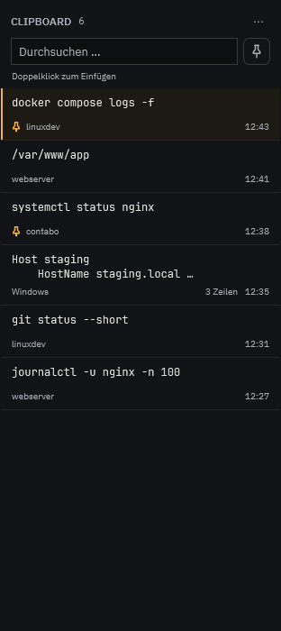

# Kompaktes Clipboard (26.10.2026)

Die dauerhafte Zeile aus Einfügen, Anheften und Entfernen ist durch ein Aktionsmenü ersetzt. Es öffnet sich per Rechtsklick oder kleinem „⋯“ bei Maus-/Tastaturfokus. Die Funktionen bleiben erhalten, einschließlich Kopieren des vollständigen Textes und aufklappbarer Volltextansicht.

Text steht oben, Herkunft/Zeit/Länge gemeinsam darunter. Pin-Symbol und schmale Akzentkante kennzeichnen angeheftete und aktive Einträge. Die Suche und ein Pin-Filter ersetzen die lange Checkbox-Beschriftung; Verlaufsaktionen liegen im Kopfmenü.

Validierung: Release-Build und eigenständiges win-x64-Paket erfolgreich. Fokussierte WPF-Tests für Menüs (alle Aktionen, Kopieren des Volltexts), kompakte Höhe, bestehende Volltextansicht und Hover-Popup bestanden. Bei 312 Pixel Spaltenbreite: Kopfbereich 81 px, einzeiliger Eintrag 58 px.

Aufruf: dotnet run --project tests/TerminalMgr.UiTests -c Release -- --clipboard-only

Der vollständige lokale UI-Testlauf wurde beendet, nachdem er in der unveränderten echten WebView2-Palettenprüfung nicht weiterlief. Die relevanten Clipboard-Prüfungen wurden separat erfolgreich ausgeführt. Die installierte laufende App wurde nicht beendet.
